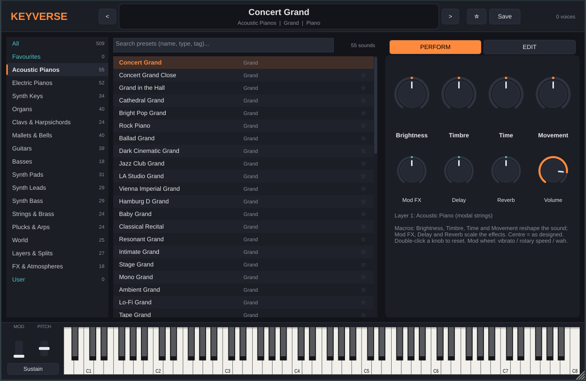
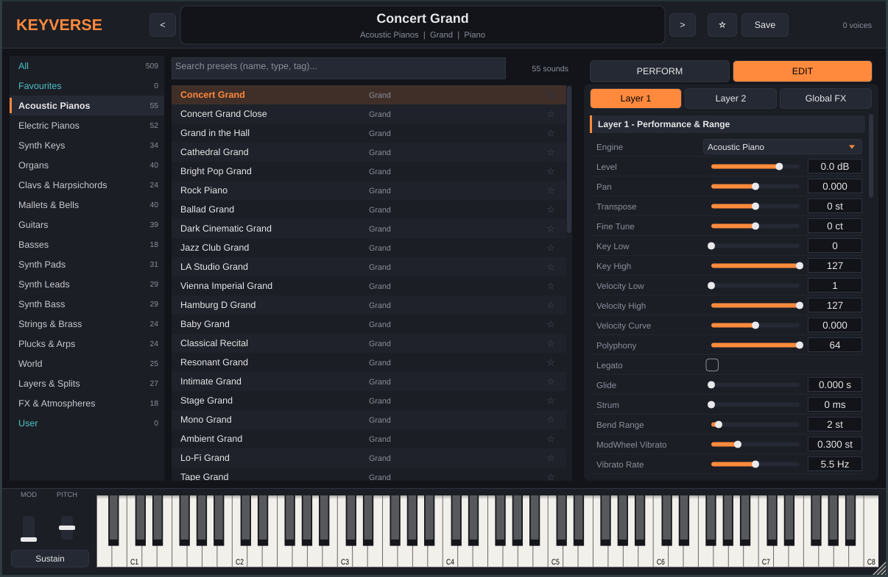

# Keyverse

**Keyverse** is a keyboard instrument plug-in in the spirit of Keyscape and Analog Lab: one
browser with **509 ready-to-play sounds** covering acoustic and electric pianos, synth keys,
organs, clavs and harpsichords, mallets and bells, guitars, basses, synth pads, leads and
basses, strings and brass, plucks and arpeggios, world instruments, layered/split
combinations and atmospheres, plus init templates for building your own sounds.

It builds as **VST3, AU (macOS), LV2 (Linux) and a Standalone app** for Windows, macOS and Linux.



## How the sounds are made

There are no sample libraries to download. Every sound is generated in real time by seven
synthesis engines, most of them physical models of the real instrument:

| Engine | Technique | Used for |
|---|---|---|
| **Acoustic Piano** | Modal synthesis of up to 96 inharmonic string partials per string, 1-3 detuned unison strings (beating and two-stage decay), a nonlinear felt hammer whose spectrum brightens with velocity, stretch tuning, dampers, half-pedalling, soundboard and sympathetic pedal resonance | Grands, uprights, felt, honky-tonk, tack, electric grand, prepared, fortepiano |
| **Electric Piano** | Tine/reed modes driving nonlinear pickup models: electromagnetic (tine "bark" and bell voicing) and electrostatic (reed growl), plus pluck excitation | Tine EPs, reed EPs, Pianet, Claviset, Cembalet, key basses |
| **Plucked String** | Extended Karplus-Strong waveguide with exact fractional tuning, stiffness dispersion, pick/finger/slap/hammer/quill excitations, pluck and pickup position, bridge buzz, multi-string courses, tremolo picking and body resonances | Guitars, basses, harpsichord, clavinet, sitar, koto, banjo, mandolin, harp, dulcimer and more |
| **Mallet & Bell** | Six-mode modal synthesis with beating doublets, resonator tubes and mallet, pluck or bowed excitation | Vibes, marimba, celeste, glockenspiel, music box, kalimba, bells, gamelan, steel pan, glass, singing bowls |
| **Organ** | Nine drawbars with tonewheel foldback, key click, percussion and scanner vibrato/chorus, plus combo, pipe, reed organ and accordion voicings | Tonewheel organs, combo organs, pipe organs, harmonium, accordion |
| **Analog Synth** | 3 PolyBLEP oscillators, supersaw, 8-voice unison, sync, ring mod and FM; transistor ladder, SVF, MS-20 style and vowel/formant filters; envelopes, 2 LFOs, glide, analog drift | Synth keys, pads, leads, basses, strings, brass, plucks |
| **FM Synth** | 6-operator phase modulation with 12 algorithms | Digital electric pianos, bells, FM basses, brass, organs |

Each layer has insert effects (compressor, auto/LFO/pedal wah, drive and guitar/bass amp
models with cabinets, EQ, and two modulation slots: chorus, ensemble, phaser, flanger,
tremolo, auto-pan, rotary speaker, vibrato, dimension). The global chain adds a
tempo-syncable ping-pong delay, an 8-channel FDN reverb, lo-fi (bit crush, sample-rate
reduction, vinyl noise, wow and flutter), stereo width and a limiter.

Presets can stack **two layers**, with key splits, velocity switches, a strum mode for
guitars, an arpeggiator and mono/legato/glide.

## Using the plug-in

- **Browser:** pick a category on the left. Acoustic Pianos, Electric Pianos and Synth Keys
  are at the top. Search by name, instrument or tag ("rhodes", "80s", "lofi", "jazz"...),
  and click a preset to load it. Star presets to add them to **Favourites**. Use `<` / `>`
  to step through the list.
- **Perform page:** Analog-Lab-style macros. **Brightness**, **Timbre**, **Time** and
  **Movement** reshape the sound. **Mod FX**, **Delay** and **Reverb** scale the effects.
  The centre position plays the preset as designed. Double-click a knob to reset it. All
  macros, plus Volume and Master Tune, can be automated from your DAW.
- **Edit page:** every parameter of every engine and effect, per layer, plus the global
  effects. Turn on Layer 2 to build your own layers or splits, then **Save** the result as a
  user preset. User presets are stored in `Documents/Keyverse/User Presets` and appear
  under **User**.
- **MIDI:** velocity, sustain pedal (with half-pedalling on the piano), soft pedal (CC67),
  mod wheel (vibrato, rotary speed or wah depending on the sound), expression (CC11),
  pitch bend and channel aftertouch. The on-screen keyboard, mod/pitch wheels and sustain
  button work with the mouse.



The full list of sounds is in [PRESETS.md](PRESETS.md).

## Download

**Windows installer:** [Keyverse-Windows-Setup.exe](https://github.com/beerjaspaldhaliwal-ctrl/Piano-sounds/releases/latest/download/Keyverse-Windows-Setup.exe).
Run it, click **More info > Run anyway** if SmartScreen warns (it is not code-signed),
then rescan plug-ins in your DAW.

The [Releases page](https://github.com/beerjaspaldhaliwal-ctrl/Piano-sounds/releases/latest)
also has a portable Windows zip and the macOS and Linux downloads. Installation steps for
every system are in [docs/INSTALL.md](docs/INSTALL.md), which is also included in each download.

Releases are built by GitHub Actions when a version tag such as `v1.0.0` is pushed. Every
other push also builds all platforms; those builds are under the **Artifacts** of each
**Build plug-in** run in the **Actions** tab (signing in to GitHub is needed to download them).

Install locations:

| Format | Windows | macOS | Linux |
|---|---|---|---|
| VST3 | `C:\Program Files\Common Files\VST3\` | `~/Library/Audio/Plug-Ins/VST3/` | `~/.vst3/` |
| AU | | `~/Library/Audio/Plug-Ins/Components/` | |
| LV2 | | | `~/.lv2/` |

The Standalone app runs without a DAW. Choose your audio and MIDI devices under **Options**.

The builds are not code-signed by a developer account. On macOS, clear the quarantine flag
once with `xattr -cr` on the `.vst3`, `.component` and `.app` (exact commands in
[docs/INSTALL.md](docs/INSTALL.md)). On Windows, click **More info** then **Run anyway** if
SmartScreen warns about the installer or the standalone app.

## Building from source

You need CMake 3.22 or newer and a C++17 compiler (Visual Studio 2022, Xcode 14+, or
GCC/Clang). JUCE is downloaded automatically during configuration.

```bash
cmake -S . -B build -DCMAKE_BUILD_TYPE=Release
cmake --build build --config Release --parallel
ctest --test-dir build -C Release          # renders and checks every preset
```

The plug-ins end up in `build/Keyverse_artefacts/Release/`.

On Linux, install the JUCE dependencies first:

```bash
sudo apt-get install libasound2-dev libjack-jackd2-dev libfreetype-dev libfontconfig1-dev \
  libx11-dev libxcomposite-dev libxcursor-dev libxext-dev libxinerama-dev libxrandr-dev \
  libxrender-dev libxi-dev libgl1-mesa-dev libegl-dev
```

Options:

- `-DKEYVERSE_BUILD_PLUGIN=OFF` builds only the engine and tools (no JUCE needed).
- `-DKEYVERSE_LTO=OFF` gives faster development builds.
- `-DFETCHCONTENT_SOURCE_DIR_JUCE=/path/to/JUCE` uses a local JUCE checkout.

### Offline renderer

`kvrender` runs the engine without any plug-in host:

```bash
build/kvrender --list                                # list all presets
build/kvrender --wav out/                            # render every preset to WAV and run checks
build/kvrender --filter "Electric Pianos"            # check one category
build/kvrender --one "Concert Grand" 60 100 4 c4.wav # render a single held note
```

For each preset the test checks for NaN/Inf, sensible levels, tuning accuracy (DFT pitch
estimate), that every voice dies away after release, and the real-time CPU factor.

## Project layout

```
Source/Engine/         sound engine (header-only C++17, no dependencies)
  Piano.h EPiano.h Pluck.h Mallet.h Organ.h Analog.h FM.h   instrument engines
  Effects.h            insert and global effects
  Synth.h              layers, voice allocation, arpeggiator, macros
  Params.h             every parameter, with ranges, used by UI, state and presets
  Instruments.h        base voicings shared by presets
  Banks/*.cpp          the factory preset banks, one file per category
Source/Plugin/         JUCE processor and editor
tools/kvrender.cpp     offline renderer and regression test
```

## A note on names

Preset names and search tags reference classic instruments so you can find the sound you
have in mind ("tine", "reed", "rhodes", "juno"...). Keyverse is an independent project, its
sounds are synthesised models, and it is not affiliated with any instrument maker.

JUCE is licensed under the AGPLv3 or a commercial JUCE licence. If you distribute Keyverse
binaries, follow the JUCE licence terms.
